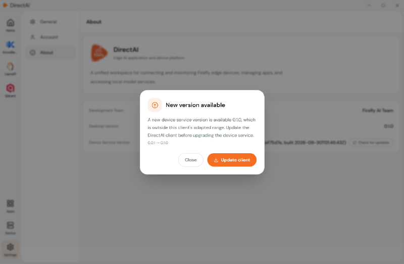
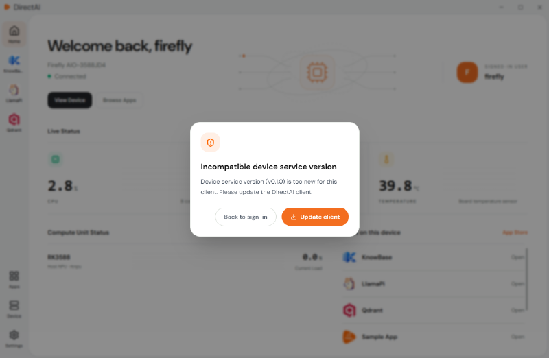

# Software Update

This section explains how to update the DirectAI client.

The client and the device-side service have version compatibility requirements. There are two kinds of prompts:

## New Version Available

Upgrading the device service depends on adaptation support from the client. When a new device service version falls outside the adaptation range of the current client, the client shows a "New version available" prompt, guiding you to update the client:

1. Check the latest version on the [Firefly Download Center](https://community.t-firefly.com/doc/download/429) page and download the new client installer.

2. Run the new installer and follow the wizard to complete the upgrade.

3. Start the client, reconnect your devices when prompted, then upgrade the device-side service as prompted.

## Device Service Incompatible

When signing in to a device, if the device-side service version is too old to be supported by the current client, a "Device service incompatible" prompt appears:

In this case, update the client first, then upgrade the device-side service:

1. Download the new client installer from the [Firefly Download Center](https://community.t-firefly.com/doc/download/429) page, then run the installer to complete the upgrade.

2. Reconnect the device and follow the client prompt to upgrade the device-side service.

## Next Steps

- Install, update, and uninstall apps: [Install Apps](./install-app.md)
- Device not connecting or sign-in failing: [FAQ and Troubleshooting](../directai/faq.md)
