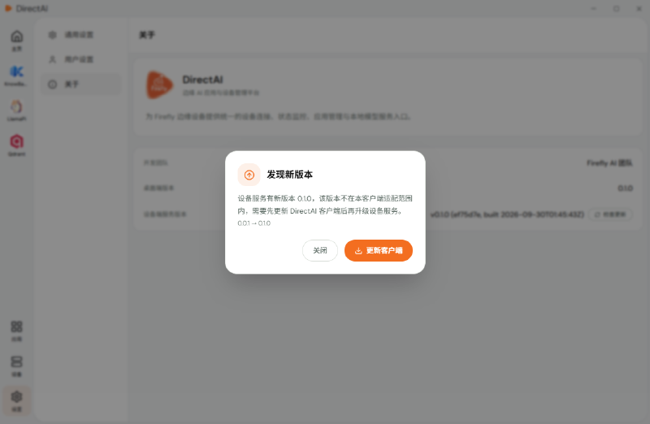
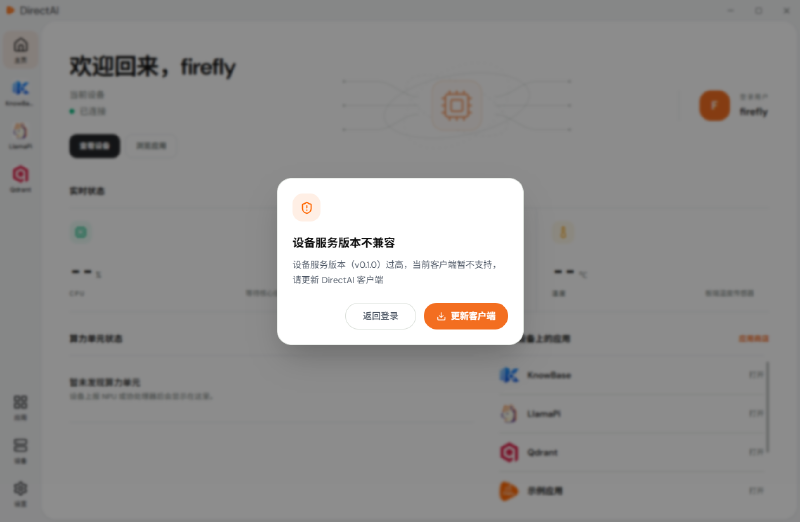

# 软件更新

阅读本节，了解如何更新 DirectAI 客户端。

客户端与设备端服务之间有版本适配关系，根据提示内容分为两种情况：

## 发现新版本

设备服务的升级依赖客户端的适配支持，当设备服务的新版本超出了当前客户端的适配范围时，客户端会弹出「发现新版本」提示，引导您更新客户端：

1. 从 [Firefly 官方资料中心](https://community.t-firefly.com/doc/download/429)下载新版客户端安装包。

2. 运行新版安装程序，按向导完成安装即可完成升级。

3. 启动客户端，按提示重新连接设备，再按提示升级设备服务。

## 设备服务版本不兼容

登录设备时，如果设备端服务版本过旧、超出了当前客户端的适配范围，会弹出「设备服务版本不兼容」提示：

此时需要先更新客户端，再升级设备服务：

1. 从 [Firefly 官方资料中心](https://community.t-firefly.com/doc/download/429)下载新版客户端安装包，运行安装程序完成升级。

2. 重新连接设备，按客户端提示完成设备端服务的升级。

## 下一步

- 应用安装、更新与卸载：[安装应用](./install-app.md)
- 设备连不上或登录失败：[常见问题与故障排查](../directai/faq.md)
